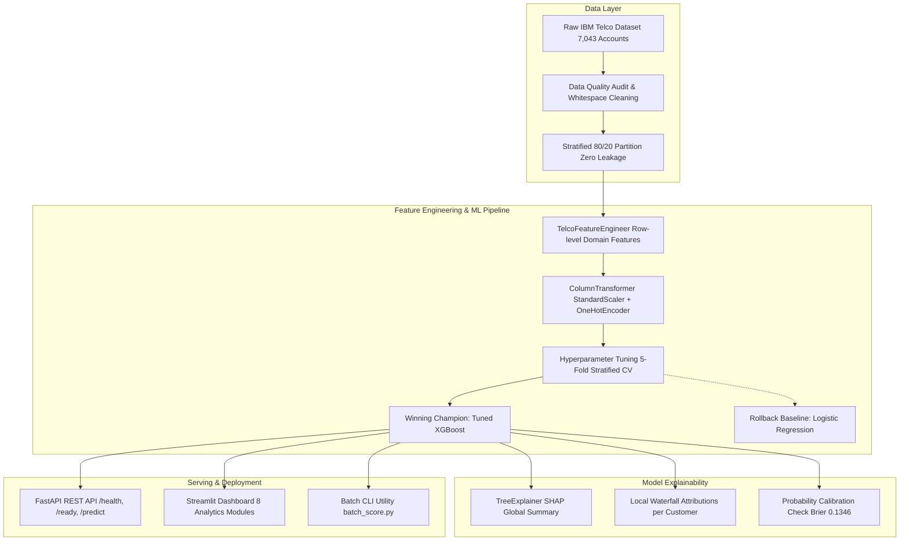

# Customer Churn Intelligence Platform
**Enterprise Machine Learning Platform for Proactive Subscriber Retention & Lifetime Value Protection**

[](https://www.python.org/)
[](https://fastapi.tiangolo.com/)
[](https://streamlit.io/)
[](https://xgboost.readthedocs.io/)
[](LICENSE)

---

## 1. Executive Summary & Business Problem

In subscription-based telecommunications, customer acquisition cost (**\$350–\$600**) is approximately **5–7× higher** than proactive retention outreach. Unchecked subscriber churn drains recurring revenue and depresses customer lifetime value (LTV).

The **Customer Churn Intelligence Platform** delivers an end-to-end, production-grade machine learning solution that:
1. Detects at-risk accounts before service cancellation occurs.
2. Identifies structural drivers of subscriber dissatisfaction via SHAP feature attributions.
3. Quantifies campaign ROI through interactive economic trade-off simulations.
4. Provides programmatic inference via an enterprise FastAPI REST service and an intuitive multi-module Streamlit dashboard.

---

## 2. Platform Architecture



---

## 3. Key Dataset & EDA Discoveries

Audited using the **IBM Telco Customer Churn dataset** (7,043 unique accounts, 26.54% base churn rate):

| Predictive Factor | Empirical Churn Rate | Practical Business Takeaway |
| :--- | :---: | :--- |
| **Month-to-month Contract** | **42.71%** | Highest churn risk cohort; accounts churn at 15× the rate of 2-year contracts (2.83%). |
| **First-Year Tenure** | **47.44% of all churn** | First 12 months constitute the critical vulnerability window. Churn probability peaks in month 1. |
| **Electronic Check Payment** | **45.29%** | Severe friction channel compared to automatic credit card billing (15.24%). |
| **Fiber Optic Service** | **41.89%** | Premium speed tier coupled with high monthly rates (\$80–\$100+) without bundled support exhibits high churn. |
| **TechSupport / OnlineSecurity** | **15.17%** | Value-add protection acts as a major retention anchor, cutting churn propensity by ~60%. |

---

## 4. Machine Learning Benchmark & Validation Results

Model comparison was conducted with strict **fold-isolated 5-Fold Stratified Cross-Validation** on training data only. The holdout test set ($N=1,409$) was evaluated strictly once:

| Model Architecture | Holdout ROC-AUC | Holdout AP (PR-AUC) | Brier Score | Decision Threshold | Test Recall | Test F1 | Selection Status |
| :--- | :---: | :---: | :---: | :---: | :---: | :---: | :---: |
| **XGBoost (Tuned)** | **0.8484** | **0.6671** | **0.1346** | **0.30** | **78.07% (292/374)** | **0.6320** | **CHAMPION (Active)** |
| **Logistic Regression (Default)** | 0.8428 | 0.6351 | 0.1379 | 0.35 | 70.86% (265/374) | 0.6257 | **BASELINE (Rollback)** |
| **HistGradientBoosting** | 0.8330 | 0.6215 | 0.1408 | 0.35 | 73.26% | 0.6145 | Benchmarked |
| **Random Forest** | 0.8219 | 0.6102 | 0.1448 | 0.35 | 71.39% | 0.5982 | Benchmarked |
| **DummyClassifier (Chance)** | 0.5000 | 0.2654 | 0.1949 | 0.50 | 0.00% | 0.0000 | Unskilled Baseline |

* **Decision Threshold ($t = 0.30$):** Selected via Out-of-Fold training cross-validation to maximize F1-score and capture **78.07% of all actual churners** (+27 additional rescues compared to baseline).
* **Calibration:** Brier score of **0.1346** confirms reliable, well-calibrated probabilities for downstream financial modeling.

---

## 5. Streamlit Interactive Dashboard

The dashboard provides a modern 8-section analytics interface:
- **Module A (Executive Overview):** Macro KPIs, base churn rates, and key findings.
- **Module B (Exploratory Analytics):** Multi-factor cross-tabulations and distributions.
- **Module C (Risk Scoring & What-If Simulator):** Live individual inference with counterfactual term changes.
- **Module D (Cohort Explorer):** Filterable customer segmentation and CSV export.
- **Module E (Retention ROI Simulator):** Customizable financial parameters (LTV, outreach cost, rescue rate).
- **Module F (Model Performance & Benchmark):** ROC curves, PR curves, confusion matrices, and SHAP feature importance.
- **Module G (Data Quality & Governance):** Missing value handling, data lineage, and ethical use policies.
- **Module H (Batch Prediction):** CSV upload, bulk scoring, risk tier assignment, and export.

---

## 6. FastAPI REST Service

Production-ready REST API featuring Pydantic schema validation, structured error handling, and health probes:

### Endpoints
- `GET /health`: Liveness probe (`{"status": "healthy"}`).
- `GET /ready`: Readiness probe verifying model pipeline is in memory.
- `GET /model-info`: Current model version, architecture, threshold, and benchmark metrics.
- `POST /predict`: Real-time single customer churn prediction.
- `POST /predict-batch`: High-throughput batch inference (up to 1,000 records per request).

### Sample Prediction Request
```bash
curl -X POST "http://localhost:8000/predict" \
     -H "Content-Type: application/json" \
     -d '{
       "customerID": "7590-VHVEG",
       "gender": "Female",
       "SeniorCitizen": 0,
       "Partner": "Yes",
       "Dependents": "No",
       "tenure": 1,
       "PhoneService": "No",
       "MultipleLines": "No phone service",
       "InternetService": "DSL",
       "OnlineSecurity": "No",
       "OnlineBackup": "Yes",
       "DeviceProtection": "No",
       "TechSupport": "No",
       "StreamingTV": "No",
       "StreamingMovies": "No",
       "Contract": "Month-to-month",
       "PaperlessBilling": "Yes",
       "PaymentMethod": "Electronic check",
       "MonthlyCharges": 29.85,
       "TotalCharges": 29.85
     }'
```

### Sample Prediction Response
```json
{
  "customerID": "7590-VHVEG",
  "churn_probability": 0.663,
  "churn_prediction": 1,
  "risk_tier": "HIGH RISK",
  "decision_threshold_used": 0.3,
  "recommended_action": "Urgent: Assign Customer Success Specialist for 1-on-1 account review, bundle upgrade, or price discount.",
  "model_version": "2.0.0"
}
```

---

## 7. Local Installation & Quickstart

### Prerequisites
- Python 3.10+ (Tested through Python 3.14)
- Git

### 1. Clone & Set Up Environment
```bash
git clone <repository-url>
cd Churn_prediction
python -m venv .venv

# On Windows:
.venv\Scripts\activate
# On Linux/macOS:
source .venv/bin/activate

pip install -r requirements.txt
```

### 2. Launch Streamlit Dashboard
```bash
streamlit run app.py
```
Open **http://localhost:8501** in your browser.

### 3. Launch FastAPI Server
```bash
uvicorn src.api:app --reload --port 8000
```
Explore the interactive Swagger UI documentation at **http://localhost:8000/docs**.

### 4. Execute Batch Scoring CLI
```bash
python src/batch_score.py --input data/WA_Fn-UseC_-Telco-Customer-Churn.csv --output reports/batch_scored_customers.csv
```

### 5. Run Automated Test Suite
```bash
python -m pytest tests/test_pipeline.py -v
```

---

## 8. Docker Deployment

### Build Container Image
```bash
docker build -t churn-intelligence-platform:v2.0.0 .
```

### Run Container (Streamlit Dashboard)
```bash
docker run -p 8501:8501 churn-intelligence-platform:v2.0.0
```

### Run Container (FastAPI REST Service)
```bash
docker run -p 8000:8000 churn-intelligence-platform:v2.0.0 uvicorn src.api:app --host 0.0.0.0 --port 8000
```

---

## 9. Model Governance & Ethical Guidelines

- **Statistical Association vs. Causation:** Feature weights and SHAP values indicate multi-feature correlation within historical account records. They do not constitute direct proof of cause and effect.
- **Prohibited Applications:** This model must never be employed for automated contract terminations, credit rating decisions, or discriminatory pricing adjustments.
- **Data Privacy:** Dataset contains no Personally Identifiable Information (PII). All account identities are synthetic identifiers (`dddd-XXXXX`).

---

## 10. Repository File Structure

```
Churn_prediction/
├── app.py                             # Enterprise Streamlit dashboard (8 modules)
├── Dockerfile                         # Production container definition
├── .dockerignore                      # Docker build exclusions
├── .gitignore                         # Version control exclusions
├── .env.example                       # Environment configuration template
├── LICENSE                            # MIT License
├── README.md                          # Master documentation
├── requirements.txt                   # Pinned dependency definitions
├── data/
│   ├── WA_Fn-UseC_-Telco-Customer-Churn.csv  # Pristine raw IBM Telco dataset
│   └── processed/                     # Leak-free split CSV partitions
├── models/
│   ├── phase2_churn_pipeline.joblib   # Active Champion Model (XGBoost Tuned)
│   ├── phase2_metrics.json            # Champion evaluation metrics
│   ├── final_churn_pipeline.joblib    # Rollback Baseline Model (Logistic Regression)
│   └── model_metrics.json             # Baseline evaluation metrics
├── reports/
│   ├── final_model_evaluation.md      # Comprehensive benchmark evaluation
│   ├── model_card.md                  # Standardized AI Model Card
│   ├── model_comparison.csv           # Head-to-head model metrics table
│   ├── data_quality_report.md         # Schema & missingness audit report
│   ├── experiment_log.md              # Complete ML training history
│   ├── deployment_checklist.md        # Pre-flight deployment verification
│   ├── final_release_report.md        # Master release audit
│   └── figures/                       # Publication-grade charts (SHAP, ROC, Calibration)
├── src/
│   ├── api.py                         # Enterprise FastAPI REST service
│   ├── batch_score.py                 # CLI batch scoring utility
│   ├── pipeline_components.py         # Custom transformers & pipeline definitions
│   └── phase2_experiments.py          # Reproducible Phase 2 training script
└── tests/
    └── test_pipeline.py               # 13 automated unit, integration, & regression tests
```
